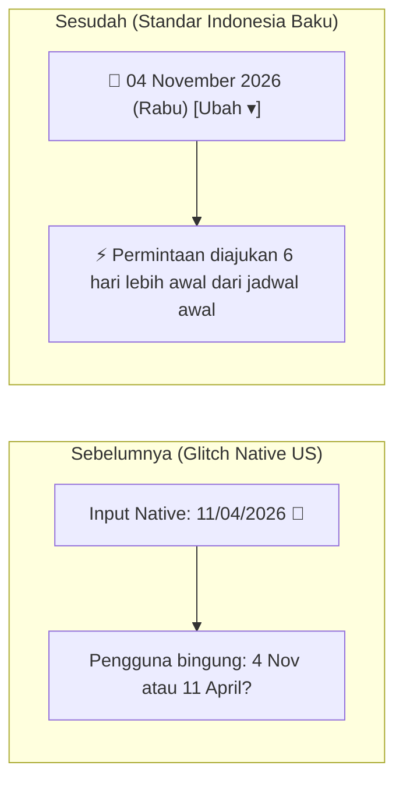

# WALKTHROUGH: Standardisasi Format Tanggal Indonesia pada Modal "Ajukan Check-in Lebih Awal" (Milestone #493)

Dokumen ini merangkum penyelesaian implementasi perbaikan format tanggal pada modal **"Ajukan Check-in Lebih Awal"** (`functions/public/pages/MyKost.tsx`).

---

## 1. Ringkasan Perubahan

Berdasarkan masukan pengguna dan tangkapan layar `media_1793777368645_e5fcae14.png`, masalah utama adalah tampilan input tanggal native yang menampilkan format US (`11/04/2026`) yang ambigu bagi pengguna Indonesia.

Solusi yang telah diimplementasikan:
1. **Locale-Aware Hybrid Date Picker UI**:
   - Menggantikan elemen `<input type="date">` polos dengan komponen kontainer visual yang menampilkan format baku Indonesia:
     - **Tanggal Baku**: `FORMAT_DATE(earlyCheckInDate)` (*contoh:* **`04 November 2026`**).
     - **Nama Hari**: `new Date(...).toLocaleDateString('id-ID', { weekday: 'long' })` (*contoh:* **`Rabu`**).
     - **Ikon Kalender**: Menggunakan vektor SVG murni `lucide-react` (`<Calendar />`).
     - **Tombol Ubah**: Badge interaksi *"Ubah ▾"*.
   - Mempertahankan native date picker perangkat melalui transparent overlay (`opacity-0 absolute inset-0 w-full h-full cursor-pointer z-10`), sehingga pengguna di HP/Desktop tetap dapat memilih tanggal secara mulus tanpa pernah melihat string mentah `MM/DD/YYYY`.
2. **Live Dynamic Context Calculation**:
   - Menghitung secara otomatis selisih hari antara tanggal yang dipilih dengan tanggal masuk awal (`selectedKost.moveInDate`).
   - Memberikan notifikasi feedback langsung:
     - Jika dimajukan: *"⚡ Permintaan diajukan 6 hari lebih awal dari jadwal awal (10 November 2026)"*.
     - Jika hari yang sama: *"Tanggal sama dengan jadwal masuk awal Anda (10 November 2026)"*.
3. **Timezone Drift Safeguard pada `FORMAT_DATE`**:
   - Menambahkan perlindungan konversi tanda hubung menjadi slash (`replace(/-/g, '/')`) untuk string `YYYY-MM-DD` agar terhindar dari pergeseran zona waktu UTC.

---

## 2. File yang Dimodifikasi

| File | Bagian / Fungsi | Deskripsi |
| :--- | :--- | :--- |
| `functions/public/pages/MyKost.tsx` | `FORMAT_DATE` | Menambahkan perlindungan timezone drift untuk format string `YYYY-MM-DD` |
| `functions/public/pages/MyKost.tsx` | `showEarlyCheckInModal` | Menerapkan Locale-Aware Hybrid Date Picker UI & Live Context Helper |
| `functions/PROGRESS.md` | Milestone #493 | Dokumentasi riwayat perkembangan fitur anti-amnesia |

---

## 3. Hasil Pengujian & Verifikasi

### A. Uji Kompilasi Front-End (Vite)
Perintah:
```powershell
npm.cmd --prefix functions/public run build
```
Hasil:
- ✓ **2512 modul ter-compile sempurna tanpa error (0 error)** dalam 37.75 detik.
- Bundle `MyKost-ywVCTxLz.js` ter-generate dengan sukses.

### B. Perbandingan Tampilan (Before vs After)



---

## 4. Panduan Pengujian bagi Pengguna

1. Buka halaman **Orders / Kost Saya** (`/my-bookings`).
2. Pada kartu sewa kost yang berstatus menunggu tanggal masuk (contoh: Kost Ryuta), klik tombol **`[⚡ JADWALKAN LEBIH CEPAT]`**.
3. Perhatikan modal **"AJUKAN CHECK-IN LEBIH AWAL"**:
   - **Tampilan Tanggal**: Sekarang tampil rapi dan jelas dalam format Indonesia: **`04 November 2026`** lengkap dengan hari **`Rabu`**.
   - **Bebas Glitch**: Format mentah `11/04/2026` sudah tidak tampak sama sekali.
   - **Live Helper**: Di bawah kotak tanggal, tampil ringkasan: *"⚡ Permintaan diajukan 6 hari lebih awal dari jadwal awal (10 November 2026)"*.
4. Klik pada kotak tanggal:
   - Dialog kalender akan terbuka otomatis.
   - Pilih tanggal lain (misal tanggal 7 November 2026).
   - Tampilan visual langsung terupdate menjadi **`07 November 2026 (Sabtu)`** dan informasi selisih hari berubah menjadi *"3 hari lebih awal"*.
5. Tekan tombol **"Kirim Permintaan"** untuk mengirim pengajuan ke pemilik kost.
